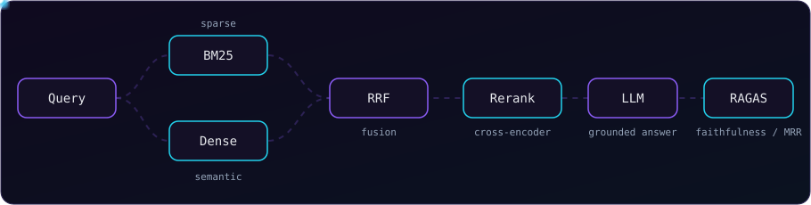

 

  

## Retrieval Architecture

  

## Technical Stack

| Domain | Technologies |
| :--- | :--- |
| **AI & Orchestration** |    |
| **Backend & Core** |    |
| **Data & Storage** |    |

## Featured Projects

<table>
  <tr>
    <td width="33%" valign="top">
      <h4>WARP Recommender</h4>
      HIPTECH · AI Engineer Intern
        
      Multi-agent product matching: intent parsing → constraint validation → scoring. Vector search + rule filters, sub-second via FastAPI.
        
      <code>Multi-Agent</code> <code>FastAPI</code> <code>Vector Search</code>
    </td>
    <td width="33%" valign="top">
      <h4>H5P Telemetry</h4>
      ITP VNU-HCM · Capstone Project
        
      Real-time xAPI telemetry platform feeding PostgreSQL analytics into the MOOC system on WordPress.
        
      <code>FastAPI</code> <code>PostgreSQL</code> <code>xAPI</code>
    </td>
    <td width="33%" valign="top">
      <h4>Automotive Voice Co-pilot</h4>
      FPT Automotive Hackathon 2026
        
      Safety-bounded, traceable agentic copilot for AAOS. <b>Top 13 / 300+ teams.</b>
        
      <code>LangGraph</code> <code>AAOS</code> <code>Tool Calling</code>
    </td>
  </tr>
</table>

<b>Research & Experiments</b>

 

- **Multi-Expert ReAct Research Agent** — LangGraph, bounded ReAct loops, controlled vs. autonomous execution.
- **RAG Optimization & Evaluation** — Naive → Hybrid (BM25 + Dense + RRF) → Rerank → GraphRAG, measured with Recall@K, MRR, Faithfulness, RAGAS.

## GitHub Activity

<picture>
  <source media="(prefers-color-scheme: dark)" srcset="https://raw.githubusercontent.com/MinhThuan2406/MinhThuan2406/output/github-snake-dark.svg" />
  <source media="(prefers-color-scheme: light)" srcset="https://raw.githubusercontent.com/MinhThuan2406/MinhThuan2406/output/github-snake.svg" />
  
</picture>

  

  

 

